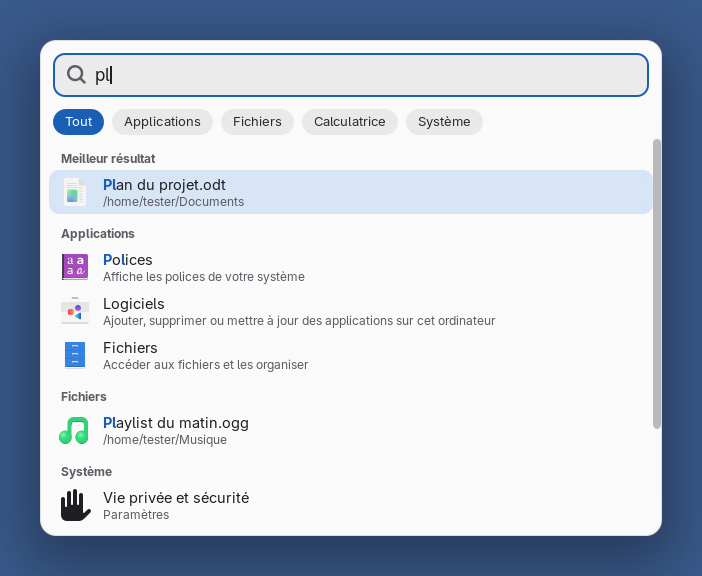
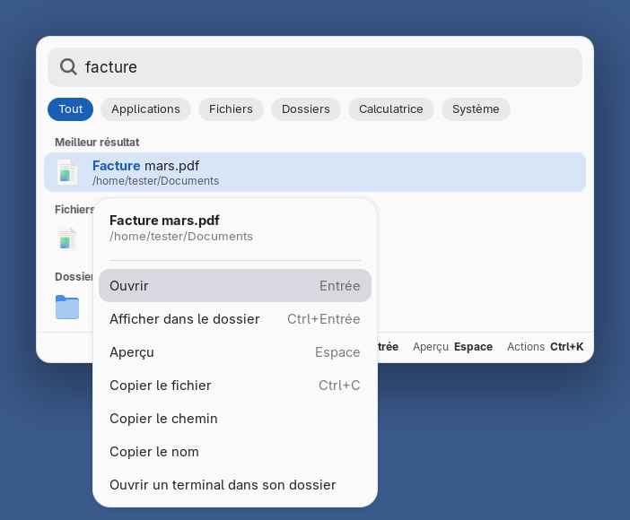
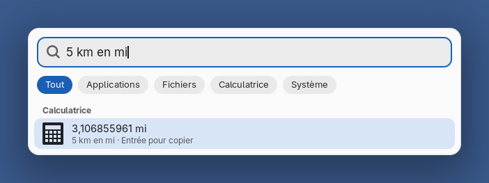
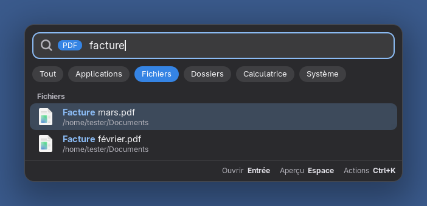

<div align="center">


# Luciole

*Éclaire ce que tu cherches.*

Un lanceur à la Spotlight pour GNOME : un raccourci, quelques lettres, et tes applications,
fichiers, réglages et réponses sont là.

[](LICENSE)
[](https://www.gnome.org)
[](https://gjs.guide/extensions/)
[](https://github.com/Gor3pig/Luciole/releases/latest)

[English](README.md) · **Français**

[Fonctions](#fonctions) · [Principes](#principes) · [Installation](#installation) · [Clavier](#clavier) · [Vie privée](#vie-privée) · [Développement](#développement)



</div>

---

## Qu'est-ce que Luciole ?

Appuie sur <kbd>Ctrl</kbd>+<kbd>Alt</kbd>+<kbd>Espace</kbd>, tape quelques lettres : une petite
fenêtre au milieu de l'écran montre ce qui correspond, au fil de la frappe. <kbd>Entrée</kbd>
l'ouvre, <kbd>Échap</kbd> range tout. Luciole est une extension de GNOME Shell : rien à lancer,
rien à garder ouvert, et elle ressemble au reste de ton bureau.

## Fonctions

<table>
<tr>
<td width="33%" valign="top">

**Chercher**<br>Applications et fichiers côte à côte, sans se soucier des accents ni des
majuscules ; les initiales et les lettres dans l'ordre suffisent.

</td>
<td width="33%" valign="top">

**Fichiers et dossiers**<br>Depuis l'index que GNOME tient déjà, les dossiers dans leur propre
section ; <kbd>/pdf</kbd>, <kbd>/images</kbd>… limitent une recherche à un type de fichier.

</td>
<td width="33%" valign="top">

**Calculer**<br>`2+2*3`, `15 % de 80`, `5 km en m`, `20 °C en °F` : la réponse vient en premier,
et <kbd>Entrée</kbd> la copie.

</td>
</tr>
<tr>
<td width="33%" valign="top">

**Système**<br>Les panneaux de Paramètres et les actions du shell : verrouiller, capture
d'écran, redémarrer… Rien de ce qui ferme ta session n'est choisi à ta place.

</td>
<td width="33%" valign="top">

**Aperçu et actions**<br><kbd>Espace</kbd> affiche un aperçu du fichier ; <kbd>Ctrl</kbd>+<kbd>K</kbd> ou un
clic droit ouvre son menu, comme dans Fichiers : afficher dans le dossier, le copier, ouvrir un
terminal à cet endroit, ouvrir avec…

</td>
<td width="33%" valign="top">

**Se souvenir**<br><kbd>↑</kbd> rappelle tes recherches précédentes, et ce que tu ouvres souvent
passe en premier.

</td>
</tr>
</table>

<p align="center">


</p>

## Principes

**Tout en local, aucun réseau** · **Rien de ce que tu tapes n'est envoyé** · **Pensée pour GNOME** · **Testée dans un vrai shell**

## Installation

Luciole demande **GNOME Shell 50 ou 51** sous Wayland. Les résultats de fichiers demandent
**LocalSearch**, l'indexeur fourni avec GNOME (les applications et le reste fonctionnent sans lui).

### Depuis une version publiée

1. Télécharge `luciole@gor3pig.github.io.shell-extension.zip` depuis la
   [dernière version](https://github.com/Gor3pig/Luciole/releases/latest).
2. Installe-le :

   ```sh
   gnome-extensions install --force luciole@gor3pig.github.io.shell-extension.zip
   ```

3. Ferme ta session et rouvre-la (sous Wayland, GNOME charge les nouvelles extensions à la
   connexion), puis active-la :

   ```sh
   gnome-extensions enable luciole@gor3pig.github.io
   ```

### Depuis les sources

```sh
git clone https://github.com/Gor3pig/Luciole.git
cd Luciole
make pack
gnome-extensions install --force dist/luciole@gor3pig.github.io.shell-extension.zip
```

Puis ferme et rouvre ta session, et active-la comme ci-dessus.

## Clavier

| Touches | Effet |
|---|---|
| <kbd>Ctrl</kbd>+<kbd>Alt</kbd>+<kbd>Espace</kbd> | ouvrir ou fermer Luciole (modifiable dans les réglages) |
| <kbd>↑</kbd> <kbd>↓</kbd> · <kbd>Tab</kbd> | se déplacer dans les résultats · passer à la section suivante |
| <kbd>Entrée</kbd> · <kbd>Ctrl</kbd>+<kbd>Entrée</kbd> | ouvrir · afficher un fichier, sélectionné, dans son dossier |
| <kbd>Ctrl</kbd>+<kbd>K</kbd>, <kbd>→</kbd> en fin de champ, ou clic droit | le menu du résultat choisi (ou de celui cliqué) |
| <kbd>Ctrl</kbd>+<kbd>C</kbd> | copier le fichier ou le dossier choisi, pour le coller dans Fichiers |
| <kbd>Espace</kbd> ou <kbd>Ctrl</kbd>+<kbd>Y</kbd> | aperçu du fichier choisi |
| <kbd>Ctrl</kbd>+<kbd>0</kbd> … <kbd>5</kbd> | tout, applications, fichiers, dossiers, calculatrice, système |
| <kbd>↑</kbd> dans le champ vide | une recherche précédente |
| <kbd>/</kbd> | un type de fichier : `/pdf`, `/images`, `/documents`, `/dossiers`… |
| <kbd>Échap</kbd> | vider le champ, puis fermer |

## Réglages

`gnome-extensions prefs luciole@gor3pig.github.io`, ou Extensions › Luciole : le raccourci, les
sources cherchées et le nombre de résultats de chacune, l'ouverture d'un résultat d'un simple ou
d'un double clic, les dossiers et types de fichiers à laisser de côté, les animations, un fond
assombri, et la mémoire des recherches (avec un bouton pour l'effacer).

<p align="center"></p>

## Vie privée

- Rien ne sort de ton ordinateur : aucun accès réseau, aucune télémétrie, aucun compte.
- Ce que tu tapes est réduit à de simples mots, transmis à l'index des fichiers comme une valeur,
  jamais comme un morceau de requête.
- Ce dont Luciole se souvient (les résultats que tu ouvres, pour les classer, et tes dernières
  recherches) reste dans `~/.local/share/luciole/`, lisible par toi seul, et s'efface depuis les
  réglages.

Le traitement de chaque donnée reçue, et la façon dont il est testé, sont décrits (en anglais)
dans [docs/security.md](docs/security.md).

## Développement

```sh
make check          # ESLint et tests unitaires (gjs seul, sans shell)
make gate           # la porte de qualité : tests unitaires, aléatoires, mutations et vrai shell
make test-gnome50   # les tests sur GNOME Shell 50, dans un conteneur podman
make capture        # captures de la fenêtre, en clair et en sombre
```

[docs/testing.md](docs/testing.md) explique les tests, [docs/architecture.md](docs/architecture.md)
le code, et [docs/performance.md](docs/performance.md) les budgets de temps (en anglais).

## Licence

Luciole est un logiciel libre publié sous la [GNU GPL v2 ou ultérieure](LICENSE).
