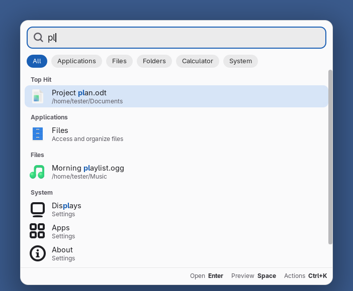
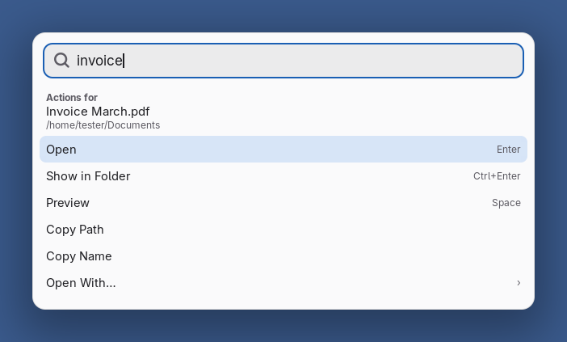
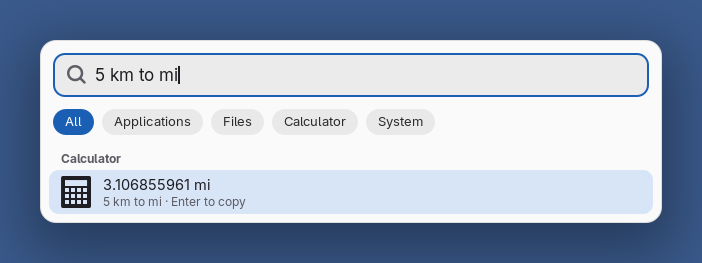
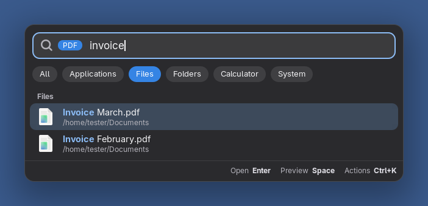

<div align="center">


# Luciole

*Light up what you are looking for.*

A Spotlight-style launcher for GNOME: one shortcut, a few letters, and your applications, files,
settings and answers are there.

[](LICENSE)
[](https://www.gnome.org)
[](https://gjs.guide/extensions/)
[](https://github.com/Gor3pig/Luciole/releases/latest)

**English** · [Français](README.fr.md)

[Features](#features) · [Principles](#principles) · [Installation](#installation) · [Keyboard](#keyboard) · [Privacy](#privacy) · [Development](#development)



</div>

---

## What is Luciole?

Press <kbd>Ctrl</kbd>+<kbd>Alt</kbd>+<kbd>Space</kbd>, type a few letters: a small window in the
middle of the screen shows what matches, while you type. <kbd>Enter</kbd> opens it, <kbd>Esc</kbd>
puts everything away. Luciole is an extension of GNOME Shell: nothing to start, nothing to keep
open, and it looks like the rest of your desktop.

## Features

<table>
<tr>
<td width="33%" valign="top">

**Search**<br>Applications and files side by side, accents and case ignored, initials and
letters in order understood.

</td>
<td width="33%" valign="top">

**Files and folders**<br>From the index GNOME already keeps, folders in a section of their own;
<kbd>/pdf</kbd>, <kbd>/images</kbd>… restrict a search to one type of file.

</td>
<td width="33%" valign="top">

**Calculate**<br>`2+2*3`, `15% of 80`, `5 km in m`, `20 °C to °F`: the answer comes first, and
<kbd>Enter</kbd> copies it.

</td>
</tr>
<tr>
<td width="33%" valign="top">

**System**<br>Settings panels and the shell's own actions: lock, screenshot, restart… Nothing
that ends your session is ever chosen for you.

</td>
<td width="33%" valign="top">

**Preview and act**<br><kbd>Space</kbd> previews a file; <kbd>Ctrl</kbd>+<kbd>K</kbd> or a right click
opens its menu, as in Files: open with…, show in folder, open a terminal there, copy it.

</td>
<td width="33%" valign="top">

**Remember**<br><kbd>↑</kbd> brings back your previous searches, and what you open often comes
first.

</td>
</tr>
</table>

<p align="center">


</p>

## Principles

**Local only, no network** · **Nothing typed is ever sent anywhere** · **Made for GNOME** · **Tested in a real shell**

## Installation

Luciole needs **GNOME Shell 50 or 51** on Wayland. File results need **LocalSearch**, the indexer
GNOME ships with (applications and the rest work without it).

### From a release

1. Download `luciole@gor3pig.github.io.shell-extension.zip` from the
   [latest release](https://github.com/Gor3pig/Luciole/releases/latest).
2. Install it:

   ```sh
   gnome-extensions install --force luciole@gor3pig.github.io.shell-extension.zip
   ```

3. Log out and back in (GNOME on Wayland loads new extensions at login), then enable it:

   ```sh
   gnome-extensions enable luciole@gor3pig.github.io
   ```

### From the source

```sh
git clone https://github.com/Gor3pig/Luciole.git
cd Luciole
make pack
gnome-extensions install --force dist/luciole@gor3pig.github.io.shell-extension.zip
```

Then log out and back in, and enable it as above.

## Keyboard

| Keys | What they do |
|---|---|
| <kbd>Ctrl</kbd>+<kbd>Alt</kbd>+<kbd>Space</kbd> | open or close Luciole (can be changed in the settings) |
| <kbd>↑</kbd> <kbd>↓</kbd> · <kbd>Tab</kbd> | move in the results · jump to the next section |
| <kbd>Enter</kbd> · <kbd>Ctrl</kbd>+<kbd>Enter</kbd> | open · show a file, selected, in its folder |
| <kbd>Ctrl</kbd>+<kbd>K</kbd>, <kbd>→</kbd> at the end of the field, or a right click | the menu of the selected result (or of the one clicked) |
| <kbd>Ctrl</kbd>+<kbd>C</kbd> | copy the selected file or folder, to paste it in Files |
| <kbd>Space</kbd> or <kbd>Ctrl</kbd>+<kbd>Y</kbd> | preview the selected file |
| <kbd>Ctrl</kbd>+<kbd>0</kbd> … <kbd>5</kbd> | everything, applications, files, folders, calculator, system |
| <kbd>↑</kbd> in the empty field | a previous search |
| <kbd>/</kbd> | a type of file: `/pdf`, `/images`, `/documents`, `/folders`… |
| <kbd>Esc</kbd> | clear the field, then close |

## Settings

`gnome-extensions prefs luciole@gor3pig.github.io`, or Extensions › Luciole, in three pages:
**General** (the shortcut, whether a result opens with a single or a double click, how many results
each source shows), **Appearance** (a dimmed background, animations) and **Search** (which sources
are searched, folders and file types to leave out, whether searches are remembered, with a button
to forget them).

<p align="center"></p>

## Privacy

- Nothing leaves your computer: no network access, no telemetry, no account.
- What you type is reduced to plain words and given to the file index as a value, never as part
  of a query.
- What Luciole remembers (the results you open, to rank them, and your last searches) stays in
  `~/.local/share/luciole/`, readable by you only, and can be erased from the settings.

How every input is handled, and how it is tested, is described in
[docs/security.md](docs/security.md).

## Development

```sh
make check          # ESLint and unit tests (plain gjs, no shell needed)
make gate           # the quality gate: unit, random-data, mutation and real-shell tests
make test-gnome50   # the tests on GNOME Shell 50, in a podman container
make capture        # screenshots of the launcher, light and dark
```

[docs/testing.md](docs/testing.md) explains the tests, [docs/architecture.md](docs/architecture.md)
the code, and [docs/performance.md](docs/performance.md) the time budgets.

## License

Luciole is free software released under the [GNU GPL v2 or later](LICENSE).
